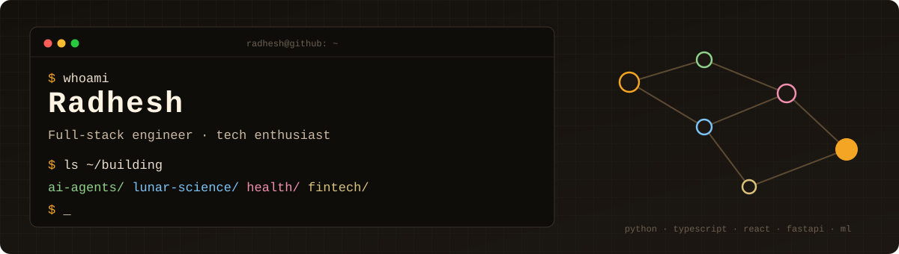
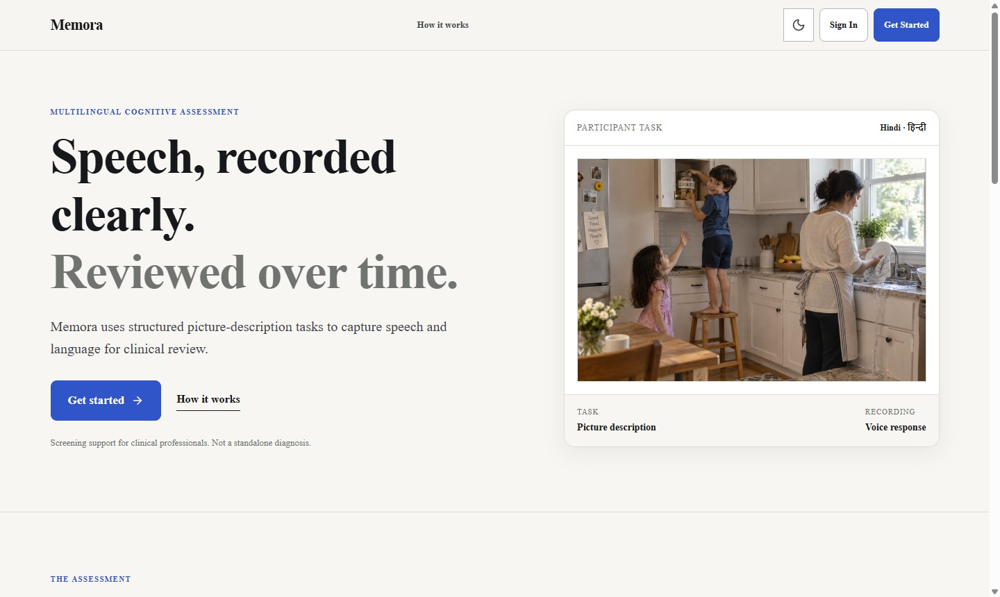
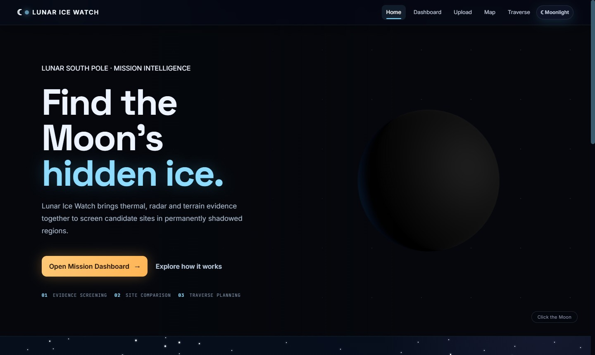
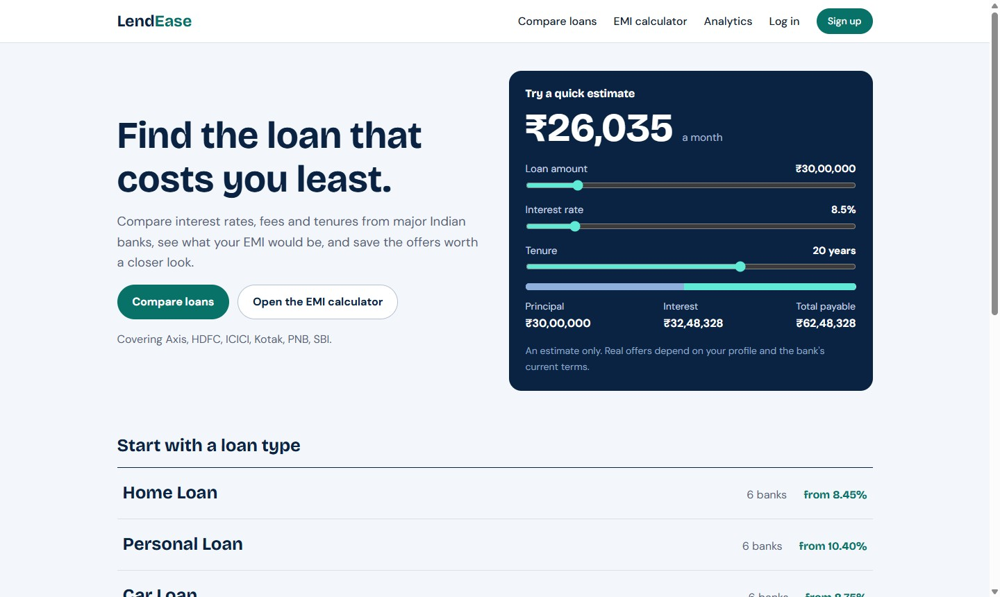

 

`Python` · `TypeScript` · `React` · `FastAPI` · `Flask` · `Three.js` · `MongoDB` · `MySQL` · `scikit-learn`

---

### What I do

I build full products, end to end: the model or algorithm, the API around it, and an interface people can use.
Most of my work sits where software meets a real domain. That means **AI agents**, **lunar science**,
**healthcare** and **personal finance**. I care about showing the evidence behind an answer, not only the answer.

---

### Featured

#### ⚡ Synapse: a compiler for AI agent workflows
Lifts an agent workflow into an effect-typed IR, profiles real runs, and rewrites it to run faster and cheaper.
A firewall proves the rewrite still gives the same answers before anything ships, and it never touches a step
that moves money or changes the outside world.
Built with team **Half a Byte** for the BitNBuild 2026 international final.

`pip install halfabyte-synapse` · [PyPI](https://pypi.org/project/halfabyte-synapse/) · Python · FastAPI · React · MCP

 

#### 🧠 [Memora](https://github.com/rad117/Dementia_project): speech-based cognitive screening
Multilingual screening and memory-assistance platform. A participant describes a picture, and the system
extracts acoustic, transcript and linguistic features for an ML classifier. A clinician reviews every case on a
dashboard. Camera-based safety monitoring (falls, wandering, appliances left on) feeds the same dashboard.
Screening aid, not a diagnostic tool.

[Live demo](https://memora-health.vercel.app) · Python · ML · Docker

 

#### 🌙 [Lunar Ice Watch](https://github.com/rad117/lunar_ice_watch): screening lunar south-pole sites for water ice
Combines radar, thermal and terrain evidence to rank candidate sites in permanently shadowed regions, with
site comparison and traverse planning. Serverless functions on Vercel, data in MongoDB Atlas.

[Live demo](https://lunar-ice-watch.vercel.app) · JavaScript · MongoDB · Vercel

 

#### 💸 [LendEase](https://github.com/rad117/Lendease): loan comparison and analytics
Compare loan products from six major Indian banks, estimate EMIs, save offers, and explore the data on an
analytics page. Flask with raw parameterised SQL on MySQL, charts in Chart.js. Every rate carries its source
and date.

[Live demo](https://lendease-ten.vercel.app) · Python · Flask · MySQL

---

### More work

| Project | What it is | Stack |
|---|---|---|
| [AMRIT](https://github.com/rad117/amrit) | Mission-intelligence platform for ISRO's Bharatiya Antariksh 2026: Chandrayaan-2 DFSAR radar to a landing recommendation, with calibrated ice likelihood, propagated uncertainty and a Monte-Carlo resource estimate (team project) | React · TypeScript · Python |
| [depexit](https://github.com/rad117/H26_TechLiers_Track1) | Finds risky dependencies in a Python project, asks Gemma 4 for a replacement, applies it in a copy and runs the real tests, then writes a replayable evidence capsule. Team TechLiers, Track 1 | Python · Gemma 4 · Docker |
| [Green Class 3D](https://github.com/rad117/greenclass3d) | Three.js classroom that switches lights, fans and AC per row based on where people sit | Three.js · JavaScript |
| [Steepest Descent Optimizer](https://github.com/rad117/Optimizer) | Full-stack app comparing step-size methods for steepest descent, after Napitupulu et al. (2018) | FastAPI · React |
